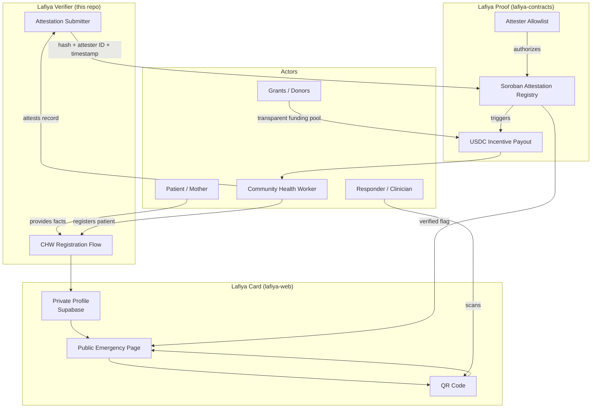

# Lafiya Verifier

[](https://stellar.org)
[](https://soroban.stellar.org)
[](<>)

The community health worker (CHW) verification tool for **Lafiya** — a free, patient-owned emergency health card. This repo will hold the dedicated CHW registration and attestation flow once it outgrows living inside `lafiya-web`.

> **Status:** Pre-alpha · Stellar **testnet** · not yet audited · not a medical device. See [Disclaimer](#disclaimer).

---

## Overview

### The Problem

In Nigeria, health records are paper, siloed per facility, and effectively lost the moment a patient moves, is referred, or arrives unconscious. In an emergency, the facts that decide treatment — especially **genotype** (AS/SS sickle-cell status), blood group, and drug allergies — are usually unknown to whoever is treating you. Wrong assumptions cost lives.

CHWs are the last-mile fix for this: they can register patients and verify records in communities a clinic never reaches. But without a way to pay them reliably and cheaply, and without a way for a responder to trust an unfamiliar CHW's verification, that last mile doesn't get covered.

### What Lafiya Verifier Does

Lafiya Verifier is the CHW-facing half of the Lafiya trust layer:

- **Registers** — lets a CHW create or update a patient's emergency profile in the field
- **Attests** — submits a hash of the verified record (never the health data itself) to the Soroban attestation registry, tying the verification to the attester's identity and a timestamp
- **Pays** — triggers the USDC-on-Stellar incentive payout to the CHW once a registration is verified on-chain

The output a responder sees is a **verified indicator** on the patient's public emergency page ([lafiya-web](https://github.com/lafiya-xyz/lafiya-web)) — cryptographic proof that a real, allowlisted attester checked the record, without exposing what was checked.

## Features

- **Field registration** — CHW creates/updates a patient's emergency profile without requiring the patient to have a login
- **On-chain attestation** — verification submits a hash + attester identity + timestamp to the Soroban attestation registry, never the underlying health data
- **Attester allowlist enforcement** — only registered, licensed health workers can produce a valid attestation
- **USDC micropayments** — CHWs are paid per verified registration, settled cheaply and cross-border on Stellar
- **Offline-first design** — the emergency page it verifies into must keep working without connectivity; the verification step itself is designed around field conditions (intermittent data, shared devices)

## Architecture



### Core Design Principle

> **No personal health data ever touches the blockchain.** Personal data lives in an encrypted, access-controlled off-chain database (Supabase). Stellar holds only hashes, attestations, and payments. This is what keeps Lafiya both privacy-respecting and regulator-compatible.

### Core Components

- **CHW registration flow** — captures the emergency-subset fields for a patient in the field; writes to the shared off-chain profile store
- **Attestation submitter** — builds the hash of the verified record and calls the Soroban attestation registry's submission function
- **Attester allowlist check** — confirms the calling CHW/health worker is licensed and registered before an attestation is accepted
- **Payout trigger** — on a successful on-chain attestation, queues the CHW's USDC incentive payment

The Soroban attestation registry and USDC payout rail live in `lafiya-contracts`; the patient-facing profile, public emergency page, and QR generation live in `lafiya-web` — see [Lafiya Organization](#lafiya-organization).

## Data Model (emergency subset)

The record a verification attests to is intentionally minimal:

- Name, age, photo
- **Blood group and genotype**
- Drug allergies
- Current medications (esp. anticoagulants, insulin, anti-epileptics)
- Chronic conditions / implants
- Emergency contact(s)
- Language spoken

Everything else (full history, documents, notes) stays private, behind authentication, and is out of scope for what this tool verifies.

## Why Stellar (core, not shoehorned)

Stellar/Soroban does two things this tool genuinely needs and a plain web form cannot: it makes a CHW's verification **tamper-evident and independently checkable** without exposing the underlying data, and it moves **stablecoin micropayments** to health workers cheaply and across borders. Remove Stellar and both the trust layer and the incentive engine disappear.

## Privacy & Compliance

- **Nigeria Data Protection Act (2023)** governs all personal data handled during registration. Consent, encryption, and minimal disclosure are designed in from day one.
- Patients opt into exactly what appears on their public page; a CHW registering them cannot expose more than that.
- No health data on-chain; only non-reversible hashes and attestations leave this tool.

## Repository Structure

This repo (`lafiya-verifier`) is currently pre-alpha and intentionally minimal:

```
lafiya-verifier/
│
└── README.md   ← This file
```

Per the Lafiya organization's build order (see [Lafiya Organization](#lafiya-organization)), CHW verification begins as a route inside `lafiya-web` and is only split out into this dedicated repo once it grows enough to need its own infrastructure. Resist scaffolding this repo ahead of that point — two working repos (`lafiya-web`, `lafiya-contracts`) beat five half-built ones.

## Quick Start

_Pre-alpha; instructions land once CHW verification splits out of `lafiya-web` (post-M1)._ Planned shape, matching the sibling repos:

```bash
git clone https://github.com/lafiya-xyz/lafiya-verifier
cd lafiya-verifier
cp .env.example .env.local   # Supabase + Stellar testnet keys, attester allowlist config
npm install
npm run dev
```

Until then, CHW registration and attestation are exercised through `lafiya-web` directly — see that repo's README.

## Tech Stack

- **Frontend / app:** Next.js, deployed on Vercel (matching `lafiya-web`)
- **Data & auth:** Supabase (Postgres, Row-Level Security, encryption at rest)
- **On-chain:** Soroban smart contracts (Rust) on Stellar; USDC on Stellar for CHW payments
- **Standards:** W3C Verifiable Credentials data model; HL7 FHIR for health-data field structure

## Testing

No automated tests yet — this repo has no code beyond this README. Test coverage is planned alongside the initial CHW registration/attestation implementation, once it splits out of `lafiya-web`.

## Roadmap

- **M0 — Public card (testnet).** One patient can create a profile and expose a working read-only emergency page via QR. _(owned by `lafiya-web`)_
- **M1 — Attestation.** Soroban registry lets an allowlisted attester verify a record; the card shows a verified indicator. _(this repo's core scope, currently inside `lafiya-web`)_
- **M2 — Incentives.** USDC-on-Stellar payout to a CHW per verified registration. _(this repo's core scope)_
- **M3 — Pilot.** Small supervised field pilot; measure verified cards created and scan events.
- **M4 — Mainnet + funding.** Launch on mainnet; open transparent funding pool.

`lafiya-verifier` is expected to split out of `lafiya-web` around M1/M2, once the CHW flow needs dedicated infrastructure.

## Why This Matters

A patient who can't speak, and a responder who has never met the CHW who registered them, both need the same thing: a way to trust a fact without a phone call to verify it. This tool is that trust step:

- **For the patient / mother** — the verified indicator on their card is only trustworthy because of what happens here
- **For the CHW** — this is how the last-mile registration work they do in the field turns into on-chain proof and a USDC payment
- **For the responder** — scanning a QR and seeing "verified" means a real, allowlisted health worker checked these facts — cryptographically, not by reputation
- **For the Lafiya project** — without a working attestation step, Lafiya Card is just an unverified form; this repo is what makes the "verified" claim real

## Funding & Public-Good Status

Lafiya is built as an open-source **Digital Public Good** (SDG 3, Good Health and Well-being).

- **Primary:** Stellar Community Fund (SCF) — Build track.
- **Bridge:** Registration against the Digital Public Goods Standard.
- **Later:** DPG-aligned and public-goods streaming funders once real-world impact is demonstrable.

## License

Recommended: **Apache-2.0** (OSI-approved, includes a patent grant — required for Digital Public Good status).

## Contributing

Issues and PRs welcome once this repo's M0/M1 work lands. Contributors agree to the project's code of conduct and license terms.

## Lafiya Organization

This project lives under the `lafiya-xyz` GitHub organization. If a change here touches a shared contract (the attestation schema, the Soroban interface, the emergency-record shape), call it out so the matching repo can be updated.

| Repo                                | Purpose                                                                                             | Priority                |
| ----------------------------------- | --------------------------------------------------------------------------------------------------- | ----------------------- |
| `lafiya-web`                        | Patient + responder web app (Next.js). Public emergency page, authed profile editor, QR generation. | **Build first**         |
| `lafiya-contracts`                  | Soroban smart contracts (Rust): attestation registry + attester allowlist. Testnet first.           | **Build next**          |
| `lafiya-docs`                       | Concept note, data model, threat model, privacy design, funding/DPG materials, references.          | Start now (lightweight) |
| `.github`                           | Organization profile README and contribution guidelines.                                            | Start now               |
| **`lafiya-verifier`** _(this repo)_ | CHW verification tool. Begins as a route inside `lafiya-web`; split out only if it grows.           | Later                   |

### Conventions for AI Agents

- Treat the shared repo table above as the source of truth for **cross-repo** priority and scope. Each repo's own README covers repo-local conventions.
- Do not scaffold this repo ahead of need — per the priority column, `lafiya-web` and `lafiya-contracts` come first.
- Keep the attestation record shape (hash, attester identity, timestamp) identical across `lafiya-verifier`, `lafiya-contracts` (Rust), and `lafiya-web` (TypeScript) once each exists — translation-layer drift is a common source of bugs.

## Disclaimer

Lafiya is an information aid, **not a medical device** and **not a substitute for professional medical judgment**. Verified indicators reflect that a record was attested by a registered health worker; they are not a clinical guarantee. Treatment decisions remain the responsibility of the attending clinician.

---

## References

These works directly informed Lafiya's design and are the intended reading for contributors to this repo.

**Books**

- Shortliffe, E. H., & Cimino, J. J. (Eds.). (2021). _Biomedical Informatics: Computer Applications in Health Care and Biomedicine_ (5th ed.). Springer. — Grounds the clinical data model: which fields are decision-relevant in an emergency, and how health records are structured and coded.
- Preukschat, A., & Reed, D. (2021). _Self-Sovereign Identity: Decentralized Digital Identity and Verifiable Credentials_. Manning. — The blueprint for this repo: issuer/holder/verifier roles, verifiable credentials, hash-based attestation, key management, and offline verification.
- Toyama, K. (2015). _Geek Heresy: Rescuing Social Change from the Cult of Technology_. PublicAffairs. — Keeps the project honest: technology amplifies human capacity rather than replacing it, which is why Lafiya centers community health workers, not the app.
- Kleppmann, M. (2017). _Designing Data-Intensive Applications_. O'Reilly. — Informs the off-chain data layer: reliable and secure storage, encryption, and the boundary between what lives in the database and what is anchored on-chain.
- Martin, R. C. (2017). _Clean Architecture: A Craftsman's Guide to Software Structure and Design_. Prentice Hall. — Discipline for an AI-assisted codebase: clear boundaries so the app, the contracts, and the data layer stay independently maintainable.

**Standards & documentation**

- Stellar Development Foundation — Stellar and Soroban developer documentation.
- W3C — Verifiable Credentials Data Model.
- HL7 — FHIR (health-data interoperability standard).
- Nigeria Data Protection Act (2023) — Nigeria Data Protection Commission.
- Digital Public Goods Alliance — DPG Standard.

---

<div align="center">

**Lafiya Verifier** — the proof behind the card.

_Built for the Stellar ecosystem. Open source. Community owned._

</div>
